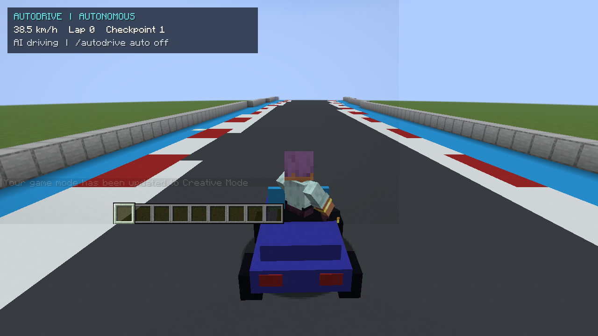

# AutoDrive

AutoDrive is a Minecraft Fabric mod that puts a self-driving car on custom racing circuits. A **PPO reinforcement learning policy** learns to steer in a Python simulator, then runs inside Minecraft through ONNX Runtime. You can switch between autonomous and manual driving in the same car.



*The trained policy driving on Rookie Circuit in Minecraft.*

## What it does

- Drives three purpose-built circuits with straights, chicanes, hairpins, barriers and checkpoints.
- Trains on two circuits and evaluates on a third, held-out layout.
- Runs inference on the Minecraft server each tick, using the car's speed and position relative to the road to choose steering, throttle and brake.
- Supports manual driving, lap tracking and a HUD alongside the autonomous mode.

## Results

The bundled `ppo_v1` policy was trained for **500,000 steps** on Rookie Circuit and Switchback Park. Grand Prix Gardens was held out of training.

| Circuit | Minecraft: laps / collisions | Simulator: completed | Mean time | Mean center deviation |
| --- | --- | ---: | ---: | ---: |
| Rookie Circuit | 1 / 0 | 20 / 20 | 46.2 s | 2.23 m |
| Switchback Park | 1 / 0 | 20 / 20 | 51.7 s | 2.34 m |
| Grand Prix Gardens (held out) | 1 / 0 | 20 / 20 | 53.0 s | 2.11 m |

Minecraft measurements are one lap per circuit from the starting grid. Simulator results are 20 episodes per circuit from randomized starts. These are small samples on similarly designed, 12-block-wide roads without traffic or obstacles; they do not establish performance on arbitrary roads. There is no baseline comparison yet.

## Try it

Requires **Java 25 or newer**. Clone the repository and start the development client:

```sh
./gradlew runClient
```

On Windows, use `./gradlew.bat runClient`. In Minecraft, create or open a single-player world with cheats enabled, then enter these commands in chat:

```mcfunction
/autodrive track build all
```

Wait for all three completion messages, then start a drive:

```mcfunction
/autodrive track go rookie
/autodrive auto on
```

The car drives itself and the HUD shows `AUTONOMOUS`. Use `/autodrive auto off` to take control, W to accelerate, A/D to steer, and S or Space to brake. F5 changes the camera view. Try the other circuits with `track go technical` or `track go grand_prix`.

The tracks are built in a dedicated test dimension. Autonomous driving requires a track car and a loaded road; use `/autodrive reset` if the car gets stuck. See the [user guide](docs/USER_GUIDE.md) for installation, controls and troubleshooting.

## How it works

The Python environment mirrors the Java vehicle physics and track geometry. PPO trains on nine observations: speed, lateral and heading errors, road direction at four distances ahead, and previous steering. The exported ONNX network turns those observations into driving controls. Each server tick, Minecraft applies the controls with its own collision handling.

```text
Python simulator → PPO training → ONNX policy
                                     ↓
Minecraft track + car → observations → policy → steering / throttle / brake
                                                    ↓
                                      vehicle physics + Minecraft collisions
```

The policy follows a known track centerline; it does not use camera vision or drive on arbitrary Minecraft roads.

| Path | Purpose |
| --- | --- |
| [`ml/`](ml/) | Simulator, training, evaluation and ONNX export |
| [`src/main/java/com/sanjay/autodrive/ai/`](src/main/java/com/sanjay/autodrive/ai/) | Observations, policy inference and autopilot |
| [`src/main/java/com/sanjay/autodrive/vehicle/`](src/main/java/com/sanjay/autodrive/vehicle/) | Vehicle controls and physics |
| [`src/main/java/com/sanjay/autodrive/track/`](src/main/java/com/sanjay/autodrive/track/) | Circuit layouts and construction |

## Development

```sh
./gradlew build              # build, unit checks and server GameTests
./gradlew runClientGameTest  # client integration test and circuit screenshots
```

For training and export instructions, see the [user guide](docs/USER_GUIDE.md#train-your-own-policy). The Python tests run with `pytest` from `ml/`. More detail: [physics](docs/PHYSICS.md), [testing](docs/TESTING.md), and [roadmap](docs/ROADMAP.md).

Licensed under [CC0-1.0](LICENSE).
