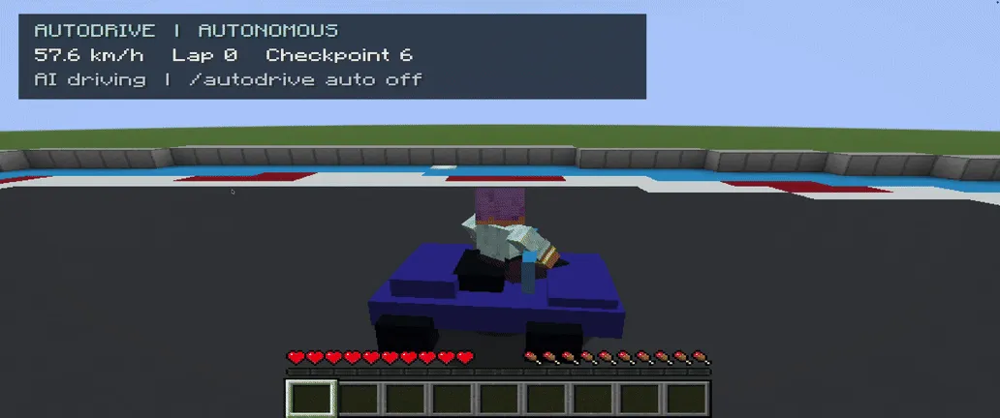
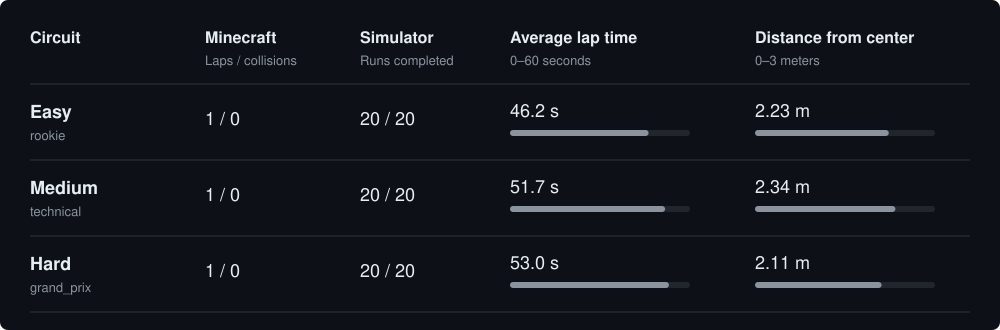
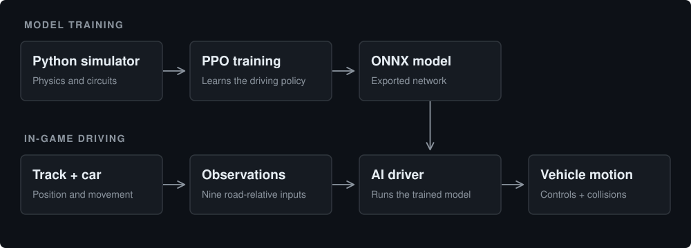

# AutoDrive

AutoDrive is a Minecraft mod that lets you drive a car or watch it drive itself around a track. The self-driving system learned in a Python simulator using **reinforcement learning**, a method where an AI improves through practice. Its trained model then runs inside Minecraft.



*The self-driving car on the Easy circuit.*

## What you can do

- Drive a car yourself or switch on the AI driver.
- Explore three custom tracks with turns, barriers, checkpoints, and a start/finish line.
- Watch your speed, laps, and next checkpoint on the screen.
- Train and evaluate your own driving model in the included Python simulator.

## Results

The AI practiced for **500,000 steps** on the Easy and Medium tracks. It was then tested on the Hard track, which it had not seen during training.



In Minecraft, the car completed one lap on each track without a collision. In the simulator, it completed 20 runs per track from random starting positions. The average times and distances from the track center shown above come from the simulator.

These are small tests on similar tracks without traffic or obstacles. They do not show how the car would perform on other kinds of roads, and there is no baseline comparison yet.

## Try the mod

You need **Java 25 or newer**. To run the game from this repository:

1. Clone the repository or download and extract it using **Code → Download ZIP**.
2. Open a terminal in the project folder and run:

   ```sh
   ./gradlew runClient
   ```

   On Windows PowerShell, use `.\gradlew.bat runClient` instead. The first launch downloads the required game and mod dependencies.
3. In Minecraft, choose **Singleplayer** and create or open a world with cheats enabled. Press **T** to open chat and build the tracks:

   ```mcfunction
   /autodrive track build all
   ```

4. Wait for all three completion messages. Then enter these commands to get in a car and start the AI driver:

   ```mcfunction
   /autodrive track go rookie
   /autodrive auto on
   ```

The screen shows `AUTONOMOUS` while the AI is driving. To drive yourself, enter `/autodrive auto off`. Use **W** to accelerate, **A/D** to steer, and **S** or **Space** to brake. Press **F5** to change the camera view.

To try the other tracks, use `/autodrive track go technical` for Medium or `/autodrive track go grand_prix` for Hard. The game uses the original track names and command IDs. If the car gets stuck, use `/autodrive reset`.

The tracks are built in a separate test dimension, so they do not change your normal world. See the [user guide](docs/USER_GUIDE.md) for installing the mod in a regular Minecraft instance, all controls, and troubleshooting.

## How it works

The project has two parts:

1. **Training:** A Python simulator recreates the car's movement and tracks. The AI practices driving there using an algorithm called PPO (Proximal Policy Optimization). The trained model is exported in ONNX format.
2. **Driving:** Inside Minecraft, the car checks its speed, position, direction, and the road ahead. The model uses that information to choose how to steer, accelerate, and brake. Minecraft then moves the car and handles collisions.



The AI follows the known centerline of a built-in track. It does not use a camera or drive on arbitrary Minecraft roads.

| Project folder | What it contains |
| --- | --- |
| [`ml/`](ml/) | The simulator and scripts for training, evaluating, and exporting the model |
| [`src/main/java/com/sanjay/autodrive/ai/`](src/main/java/com/sanjay/autodrive/ai/) | The code that prepares driving information and runs the model |
| [`src/main/java/com/sanjay/autodrive/vehicle/`](src/main/java/com/sanjay/autodrive/vehicle/) | Car controls and movement physics |
| [`src/main/java/com/sanjay/autodrive/track/`](src/main/java/com/sanjay/autodrive/track/) | Track layouts and construction |

## Development

```sh
./gradlew build              # Build the mod and run automated checks
./gradlew runClientGameTest  # Run the in-game client test and capture screenshots
```

To train a model yourself, follow the [training and export instructions](docs/USER_GUIDE.md#train-your-own-policy). To run the Python checks, run `pytest` from the `ml/` folder. More details: [vehicle physics](docs/PHYSICS.md), [testing](docs/TESTING.md), and the [roadmap](docs/ROADMAP.md).

Licensed under [CC0-1.0](LICENSE).
